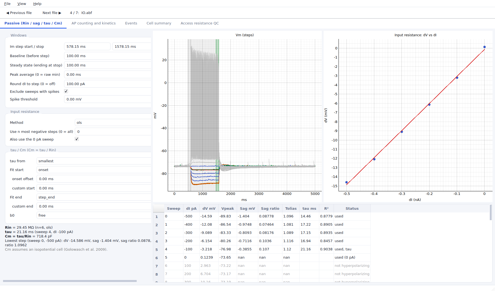
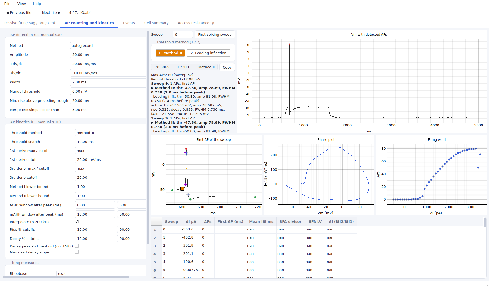
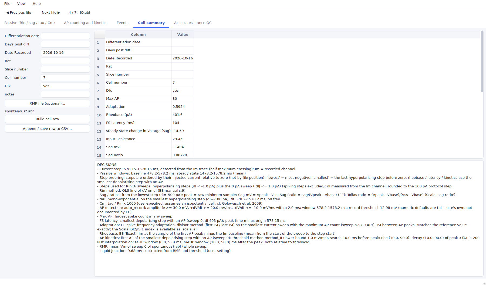
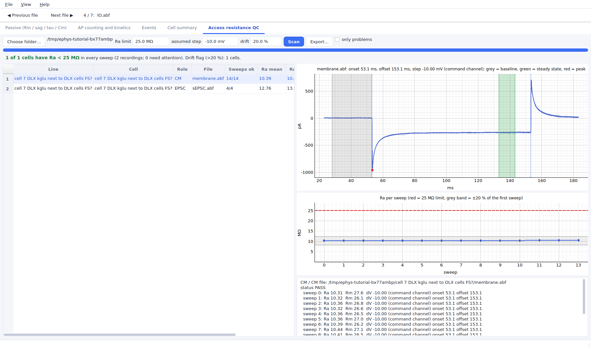
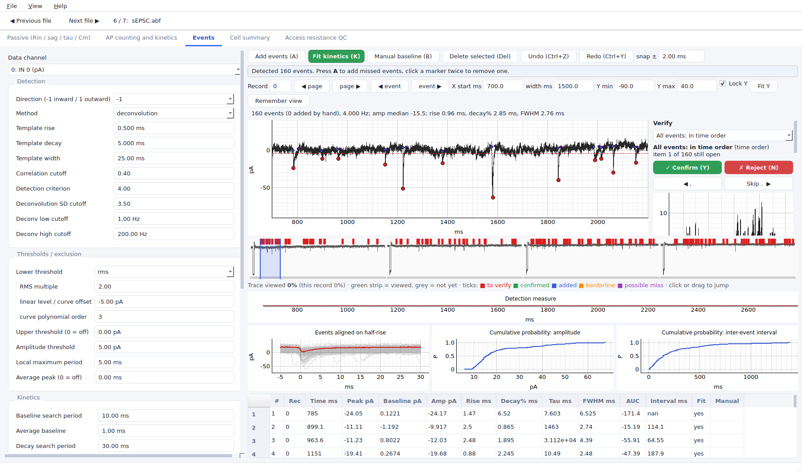
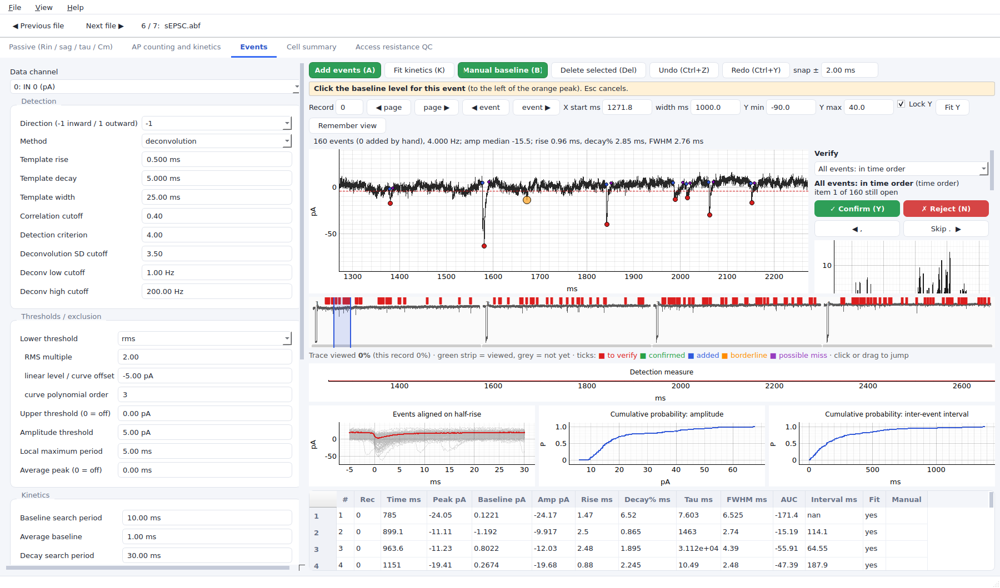
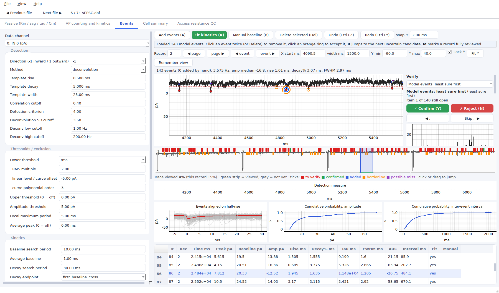
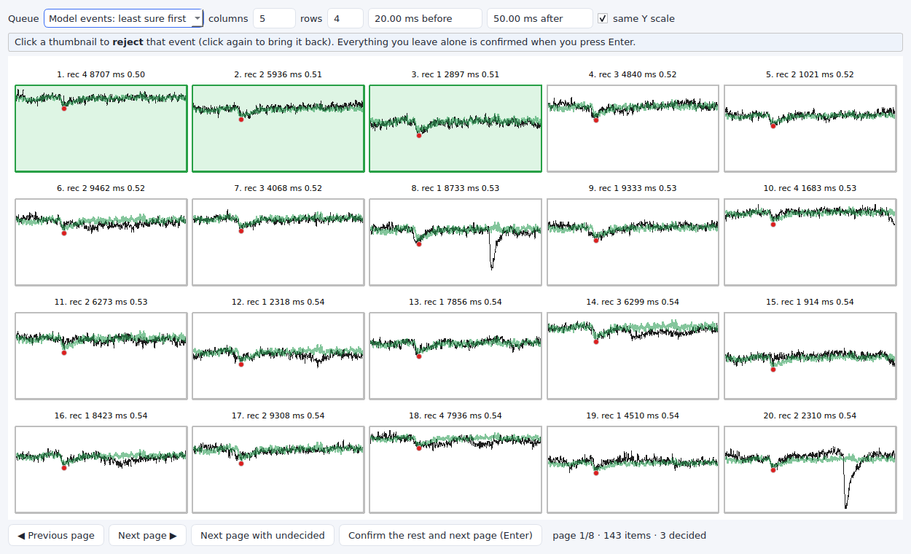
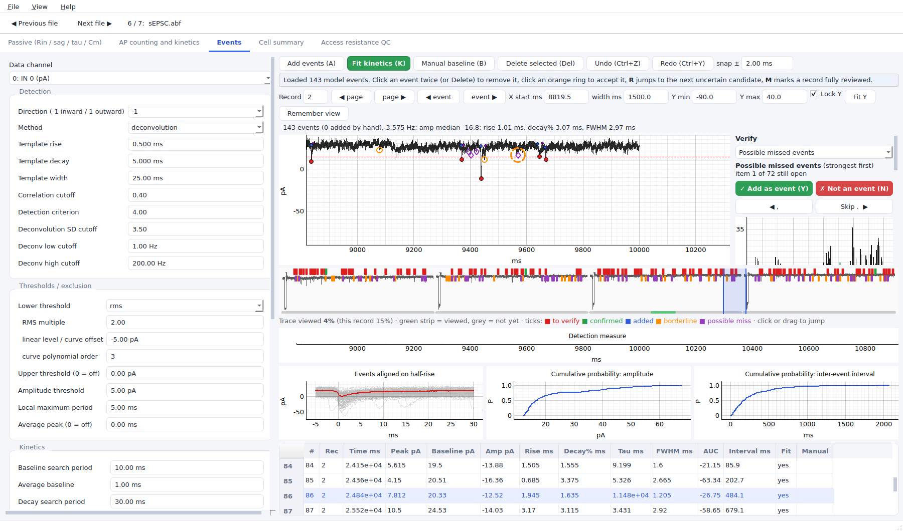

# ephys-suite tutorial

A hands-on walkthrough on one example cell (`cell 7 DLX kglu next to DLX cells FS?`, zip in the repository root). About 45 minutes
for everything; each part also stands alone. Numbers quoted below are what the app showed on that cell when this tutorial was
written; yours should match to the digits shown (if not, check the settings first, see *Troubleshooting*).

> Read before trusting any number: the tool prints its decisions (README, section "DECISIONS to check"). Where a choice is
> mine rather than from the Easy Electrophysiology manual or a paper, it is listed there. I am not certain every default
> equals what your lab uses; check them against your own pipeline.

## 0. Set up

```bash
unzip "cell 7 DLX kglu next to DLX cells FS?.zip" -d ~/ephys-practice     # a new, empty folder
cd ephys-suite && pip install -e .                                          # PySide6, pyqtgraph, pyabf, numpy, scipy, openpyxl
ephys-suite                                                                 # opens the window
```

*File > Open...* and choose `IO.abf` inside the unzipped folder. The top bar shows `Previous file / Next file` and
`n / N: name`, which walk through all `.abf` files in the same folder, so you can open once and move on. Tabs:

| Tab | What it is for | File to use |
|---|---|---|
| Passive (Rin / sag / tau / Cm) | input resistance, sag, tau, Cm from hyperpolarizing steps | `IO.abf` |
| AP counting and kinetics | spikes per step, rheobase, AP shape | `IO.abf` |
| Events | sEPSC / sIPSC detection, editing, verification | `sEPSC.abf` |
| Cell summary | one row with every measure, copy to a spreadsheet | all of the above |
| Access resistance QC | Ra / Rm of every cell in a folder tree | folder above the cell |

## 1. Passive properties (Rin, sag, tau, Cm)

Open `IO.abf`, tab **Passive**.



1. The steps are ordered by injected current relative to zero: the lowest (most negative) is first, the smallest
   hyperpolarizing step is the last one before zero. The step timing is detected from the data (here 578.15 to 1578.15 ms) and
   can be edited.
2. **Rin** is the slope of the line fitted to voltage change (mV) against current (nA), plotted with the fit. Result for this
   cell: **29.45 MOhm** (6 points, including the 0 pA sweep because the box *Also use the 0 pA sweep* is ticked; 28.36 MOhm
   without it). The measurement window is the last 100 ms of the step.
3. **tau** comes from a mono-exponential fit to the response of the smallest hyperpolarizing step (here sweep 4, -100 pA):
   **21.16 ms**. The fit window defaults to the whole current injection; the slider moves its end point.
4. **Cm = tau / Rin = 718.4 pF.** This is the convention you asked for. Golowasch et al. 2009 argue that tau / R0 is the
   correct form for cells that are not isopotential; that is shown as a reference line only, not as the result.
5. **Sag** (lowest step, -500 pA): voltage change -14.59 mV, sag -1.40 mV, sag ratio 0.0878 (EE definition: sag / (Vpeak - Vbase)),
   and 1.0962 for the other definition ((Vpeak - Vbase) / (Vss - Vbase)). Both are shown because papers differ; use the one your
   comparison data used.

Try: drag the fit-window slider and watch tau change; untick the 0 pA box and see Rin move to 28.36.

## 2. AP counting and kinetics

Same file, tab **AP counting and kinetics**.



- Spikes per step are counted with a 20 mV prominence rule and a 3 ms merge window (your local change).
- **Rheobase** is the lowest current with a spike (the exact value is interpolated, see the README for the RANSAC variant).
  Here the first AP is in sweep 9.
- **Method buttons (1 / 2)** switch the AP threshold method; the default is **Method II (Sekerli et al. 2004)**. On this cell:
  threshold -47.50 mV, amplitude 78.69 mV, FWHM 0.730 ms. The leading-inflection method gives -50.80 mV for the same spike, which
  shows how much the threshold definition matters. Pick one method for a whole data set.
- Maximum APs: 80, in sweep 37. **F** jumps to the first spike; **Copy** puts file, sweep, threshold, amplitude, half-width and method on the clipboard (tab-separated).

## 3. Cell summary



The tab collects the measures in the order of your reference spreadsheet. For this cell: rheobase 401.55 pA, first-spike latency
104.05 ms, adaptation index 0.592, RMP -73.561 mV (liquid-junction corrected -83.241 mV), Cm 718.4 pF. Two values differ
from your own reference row because I could not reproduce the exact windows you used (the passive measurement window and the
first-spike latency definition); they are listed in the README. **Build cell row** assembles it and **Append / save row to CSV...** writes it (check the tab for the exact copy option).

## 4. Access-resistance QC (Ra < 25 MOhm)

Command line, on the folder that holds your cell folders (for practice use the folder one level above the unzipped cell):

```bash
ephys-suite-qc ~/ephys-practice
```

Result on this cell: 1 of 1 cells pass; `membrane.abf` (test pulse): Ra 10.4 MOhm over 14 sweeps; `sEPSC.abf`: mean Ra 12.76 MOhm over
4 sweeps, with a **drift flag** (10.7 to 13.9 MOhm, past the 120 % / 80 % rule). Drift is a separate flag; the verdict is
PASS / WARN / FAIL / NO PULSE against Ra < 25.



In the GUI tab, click a row to see the detected pulse and the three windows (baseline, peak, steady state), so every detection can be
checked by eye. Pulse onset and offset come from the command channel, or from the capacitive transients if there is none. If
no command channel exists, a -10 mV step is assumed and its sign is inferred; this is an assumption, so confirm it matches your
protocol with `--vstep`. An Excel file `Ra_QC_<date>.xlsx` is written into the folder.

## 5. Detecting sEPSCs and editing them

Open `sEPSC.abf`, tab **Events**.



1. Left: detection settings. Defaults: inward events, deconvolution method (Pernia-Andrade), template rise 0.5 ms / decay 5 ms, SD cutoff 3.5, lower
   threshold = RMS x 2, amplitude threshold 5 pA. Fill *Omit time period in every record* with `0` to `400` ms to skip the test
   pulse at the start of each sweep, then press **Run event detection**. Result: 160 events at 4.000 Hz.
2. Move with **page / event** buttons (keys: **X** or PageDown = next window, **Z** or PageUp = previous, arrows = next / previous event), set the view with *X start*, *width*, *Y min / Y max*; **Lock Y** keeps the vertical range between
   records, **Fit Y** rescales, **Remember view** stores it.
3. **Add events (A)**: toggle on, click a trace position; the peak is snapped (+/- 2 ms) and kinetics are measured. If **Fit kinetics
   (K)** is off, the event is added without fitting. **Manual baseline (B)**: toggle on, click an event, then click where the baseline is;
   the toggle turns itself off afterwards. **Delete selected (Del)** removes the selected event (also by clicking an event
   twice). **Ctrl+Z / Ctrl+Y** undo and redo everything, including baseline changes.



The table at the bottom lists every event (peak, baseline, amplitude, rise, decay, tau, FWHM, AUC, interval, whether it was fitted, whether
it was set by hand); click a row to jump to it.

## 6. Verifying model-predicted events and finding misses

The classifier weights are not trained in this repository, so practise with candidates made by the ordinary detector. This
makes a CSV in the same format as the classifier output (`sweep, time_in_sweep_ms, score, accepted`):

```bash
python scripts/make_demo_candidates.py ~/ephys-practice/*/sEPSC.abf --out ~/ephys-practice/practice.candidates.csv --omit 0 400
```

It gave 206 candidates for this file (143 accepted, 63 borderline). These scores come from signal-to-noise, not from a
model, so they only teach the workflow; they say nothing about how good the real model is.

In the Events tab, in the left panel's *Review model events* group press **Load model candidates (CSV)...** and choose the CSV. Accepted candidates become the events.



- **Verify card** (right): the current item zoomed, with the baseline, peak, score, SNR, gap to the previous event, and a green
  line = typical event scaled to this amplitude, so a wrong shape stands out. **Y / Enter** confirm, **N** reject, **.** skip,
  **,** back. Counts at the bottom of the card show what is still open.
- **Queue** drop-down: model events least sure first (default), all events in time order, borderline candidates, possible
  missed events.
- **Gallery (G)**: 20 thumbnails per page on the same Y scale. Click one to flip it; **Enter** confirms everything you left alone and turns the
  page.



- **Overview strip** (under the trace): all records side by side; ticks are red = to verify, green = confirmed, blue = added by
  hand, orange = borderline, purple = possible miss. The green/grey line shows what you have *actually looked at*; a stretch counts
  only if the window is 2.5 s or narrower and stays on screen for 0.35 s. **V** jumps to the next unviewed stretch, so
  finding misses is a loop: look, **A** to add what you see, **V**.
- **Possible miss (F)**: a second, more permissive deconvolution detector (2.5 SD, SNR >= 3) flags places that are not events. **Y** adds,
  **N** dismisses, a click on a purple diamond focuses it. It is a second detector, not proof: an event that looks like noise to both
  the model and this detector is not flagged; the coverage strip is what shows you looked everywhere.



- **Resume / save**: decisions and coverage autosave 1.5 s after each change to `<candidates>.review_progress.json`; *Resume saved
  review* restores them later. *Save review...* writes the CSV with extra columns `decision` and `record_viewed_pct`.

For real model output, run `ephys-suite-classify cell.abf --model <bundle>.pkl --out candidates/` and load the resulting CSV the
same way. Untested caveat: that command has not been run with real weights.

## Fitting the window to your screen

The window opens at up to 94 % of your screen and remembers its size, the splitter positions and which panels you hid. Toolbars wrap
onto a second row instead of being cut off; below 1000 x 620 px the page scrolls. **View** menu: tick or untick any panel per tab
(settings column, small plots, table, verify card, overview strip...), pick a preset such as *Events: verify focus*, or
*Reset layout*. On screens shorter than 860 px the two small Events plots start hidden so the trace has room.

## Key cheat sheet

| Key | Action |
|---|---|
| A / B / K | toggle add events / manual baseline / fit kinetics |
| Del, Ctrl+Z, Ctrl+Y | delete selected, undo, redo |
| X or PageDown / Z or PageUp | next / previous window |
| F1 | list of all shortcuts (Help menu) |
| Y or Enter / N | confirm (or add) / reject (or dismiss) |
| . / , | next / previous item |
| E | next event to verify |
| F / Shift+F | next / previous possible miss |
| V | next unviewed stretch |
| G | gallery |
| R / M | next uncertain candidate / mark record reviewed |

Keys are ignored while you type in a box.

## Troubleshooting and what is decided for you

- **Numbers differ from this page:** check *Also use the 0 pA sweep*, the fit window, the threshold method (Method II) and the omit
  period before suspecting the code.
- **The trace looks empty at first:** the Y range is set from the signal's median and noise; press **Fit Y** if needed.
- **Hand edits vanish after Run event detection:** keep *Keep manual edits when re-running* ticked.
- **No progress file appears:** review progress is only saved while the Events tab is the visible tab.
- **Licensing:** the Easy Electrophysiology GPL code and the Allen non-commercial feature code were re-implemented, not copied.
  Check the README's licensing note with your institution if you plan to distribute the package.
- **Unverified:** the CNN has not been tested with real weights, the suspect thresholds (2.5 SD, SNR >= 3) have not been tuned on your
  data, and the QC result on your actual data folder is unknown until you run it.
