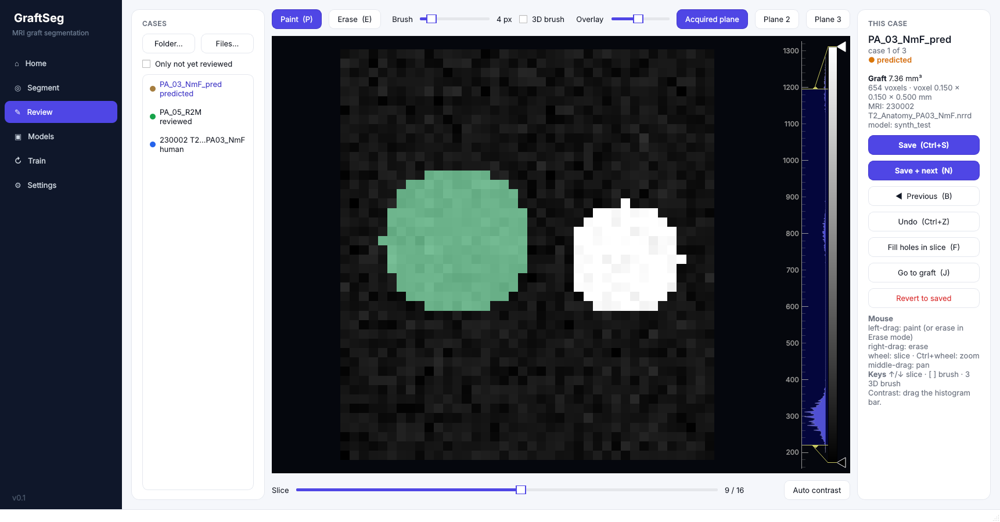
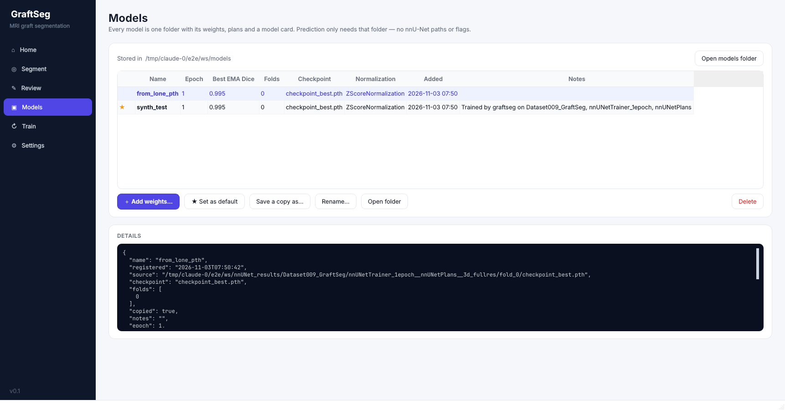

# GraftSeg

Automatic segmentation of transplanted organoid grafts on T2-weighted rat MRI (nnU-Net), in one desktop app:
**segment new scans → review and correct them → keep the corrected ones → retrain**. Every output is a
3D Slicer `.seg.nrrd` named after the animal (`PA_01_R2M.seg.nrrd`). Runs on Linux with or without an NVIDIA GPU.



## Install (once)

```bash
cd mri-graftseg
bash install.sh
```

- If nnU-Net already works in your Python (it does on the machine you trained on), GraftSeg is installed there and
  your PyTorch/CUDA setup is not touched.
- Otherwise it makes `~/graftseg-env`, installs a PyTorch build that matches your NVIDIA driver, and adds GraftSeg to the
  app menu. `graftseg doctor` shows what it found (paths, GPU, packages, models).

## First run

```bash
graftseg
```

1. **Settings**: choose the workspace, the folder that holds `nnUNet_raw`, `nnUNet_preprocessed` and `nnUNet_results`
   (for you that is probably `/media/pasca/Extreme SSD/MRI NeuralNetwork`). That's the only path you set. The
   `nnUNet_*` environment variables are set automatically from it, so you don't need any `export` lines.
2. **Models → Add weights…**: point at your trained weights. Any of these works:
   - the `.pth` file itself, e.g. `saved NN weights/checkpoint_best.pth`. nnU-Net stores the plans and labels inside
     the checkpoint, so the file alone is enough;
   - a `fold_0` folder, or the whole `nnUNetTrainer__nnUNetPlans__3d_fullres` folder (several folds = ensemble).

   Give it a name (e.g. `graft_v1_epoch251`). It is copied to `<workspace>/models/<name>/` with a model card (epoch,
   best EMA Dice, normalization, source path, date) and becomes the default. **Save a copy as…** writes it to any folder
   under any name (USB stick, another computer). **Folder…** in *Add weights* reads such a copy back in.



## Daily use

| Page | What it does |
|---|---|
| **Segment** | Add folders (or drag them in). The app finds Bruker enhanced DICOM (`EnIm1.dcm`), classic DICOM series and `.nrrd` scans, and picks the T2 anatomy series when a folder has several. Next to each scan it writes `<Cage>_<EarTag>.seg.nrrd` plus the MRI as `<Cage>_<EarTag>.nrrd`, so Slicer opens the pair and the folder can be used for training later. **Preview names** shows what will be written before anything runs. A summary CSV (volume in mm³, number of separate pieces, flags for empty / tiny / multi-piece results) goes into the first folder. |
| **Review** | Left-drag paints, right-drag erases (or switch to **Erase**). Mouse wheel changes slice, Ctrl+wheel zooms, middle-drag pans. **Window/level**: drag the histogram bar on the right; **Auto contrast** resets it. Use this for the saturated bright grafts. **3D brush** paints a ball across neighbouring slices. Also: **Fill holes**, **Undo** (30 steps), and three viewing planes. **Save + next (N)** writes the file as *reviewed*. Other segments in the file (fluid, black spot) are kept. |
| **Models** | Add / rename / set default / save a copy / delete. Double-click a row to make it the default. |
| **Train** | Step 1 *Check data* lists every segmentation found and which segment counts as graft. *Build dataset* converts them to nnU-Net format. Step 2 trains: choose length, network (default U-Net or ResEnc M/L/XL), folds, and a name to save the model under when it finishes. **Stop** is safe; **Start** again continues from the last checkpoint. *Refresh progress* shows epoch, best EMA Dice and when it was reached. |

Naming: the cage and ear tag come from the DICOM *SeriesDescription*, otherwise from the folder or file name
(`PA05_R2M`, `PA_05-R2M` and `PA05 R2M` all become `PA_05_R2M`). If no cage/ear tag can be found, the folder name is
used, so no scan is skipped. A segmentation a person made is never overwritten: the prediction is saved as
`…_pred.seg.nrrd` instead, and its Dice against the person's version goes in the summary CSV.

## The retraining loop

Model predictions are saved as *predicted*; once you save them in Review they become *reviewed*. **Build dataset**
uses human-made and reviewed segmentations and skips predictions nobody checked. So the loop is: segment → review →
add the folders under Train → build → train → the new model appears on the Models page.

Each built dataset folder (`nnUNet_raw/DatasetNNN_GraftSeg/`) contains:
- `manifest.csv`: for every training case, the source MRI and segmentation file, which segments were used as graft
  and which were ignored, graft volume, and the cross-validation fold. Skipped files are listed with the reason.
- `splits_final.json`: animal-level folds (all timepoints of an animal in the same fold), copied to nnU-Net
  automatically before training.
- `build_info.json`: sources, options and date.

The manifest is also copied into the trained model's folder, so every model records which scans it was trained on.

## Command line (same functions, for scripts or SSH)

```bash
graftseg setup --workspace "/media/pasca/Extreme SSD/MRI NeuralNetwork"
graftseg model add "/path/to/saved NN weights/checkpoint_best.pth" --name graft_v1_epoch251
graftseg model list
graftseg predict "/path/to/Pasca_2026" --review          # --fast, --device cpu, --overwrite, --dry-run
graftseg review "/path/to/Pasca_2026" --only-unreviewed
graftseg scan "/home/pasca/Documents/Ayaka/Ayaka_MRI quantyfication"
graftseg build "/home/pasca/Documents/Ayaka/Ayaka_MRI quantyfication" \
    --include-nnunet "/media/pasca/Extreme SSD/MRI NeuralNetwork/nnUNet_raw/Dataset001_GraftSeg" --id 3
graftseg train --dataset 3 --folds all --epochs 1000 --register-as graft_v2
graftseg train-status --dataset 3
graftseg repair-old "/path/to/folders"   # fixes .seg.nrrd written by the old predict_grafts.py (see below)
```

## Where everything lives

```
<workspace>/                     e.g. /media/pasca/Extreme SSD/MRI NeuralNetwork
  nnUNet_raw/DatasetNNN_*/       training datasets + manifest.csv, splits_final.json
  nnUNet_preprocessed/           nnU-Net's preprocessed copies (can be deleted and rebuilt)
  nnUNet_results/                raw training output: all checkpoints, logs, progress.png
  models/<name>/                 registered models: MODEL_CARD.json, plans.json, dataset.json, fold_N/checkpoint_*.pth
~/.config/graftseg/config.json   the settings (workspace, default model, device)
```

## Read before relying on it

- **Old `.seg.nrrd` files from `predict_grafts.py` are transposed.** That script saved an (x, y, z) array with
  `index_order='C'`, which writes the axes in reverse order relative to the voxel spacing. Its own editor looked fine,
  but in Slicer the mask does not line up with the MRI. `graftseg repair-old <folder>` fixes those files in place (it
  only touches files with that script's `ParentCage:` tag and is safe to run twice).
- **`run_training.sh` never started training**: `nnUNetv2_train` has no `-num_epochs` option. GraftSeg uses nnU-Net's
  built-in trainers for 250 / 500 / 750 / 1000 / 2000 / 4000 epochs instead. There is no 1500, so pick 1000 or 2000.
- `prepare_pa_data.py` (checked by running its conversion function on synthetic Slicer files):
  - It turns **every** non-zero voxel of a `.seg.nrrd` into graft, so black spot / CSF segments become graft.
  - It crashes on 4D (multi-layer) Slicer files, and the case is then skipped.
  - When Slicer saved the segmentation on a cropped box, the label ends up a different size from the MRI.

  Whether your PA files contain extra segments, layers or cropped boxes is not known yet. `graftseg scan <folder>`
  lists them. `generate_splits.py` dropped a case when one animal had two scans with the same timepoint, and treated
  `Assembloid03_L1F` and `Assembloid_03_L1F` as different animals. `graftseg build` handles all of these.
- Tested here on synthetic Slicer-format data: build, preprocess, 1-epoch CPU training, register, predict from DICOM and
  NRRD, edit, save. That includes an oblique multi-frame DICOM, checked against the old converter's geometry. **Not yet
  tested on your real scans or opened in 3D Slicer itself**: please open one `PA_xx.nrrd` + `.seg.nrrd` pair in Slicer
  and check that it lines up.

The original Biomni scripts are kept unchanged in [`legacy/`](legacy/). The data and labeling decisions are in
[docs/DATA_DECISIONS.md](docs/DATA_DECISIONS.md).

## Development

```bash
pip install -e .[test]
QT_QPA_PLATFORM=offscreen pytest
```
