# Tutorial: from data to a numbered, aligned, self-updating figure

About 20 minutes. You will build a figure from two real plotsuite graphs plus a micrograph, add a legend that
cites panels by number, shuffle the panels around, move one into the supplement, then change the data and watch the
figure update itself.

Everything below was run against the real app; the screenshots are generated from it
(`node docs/make-screenshots.mjs`). Example files are in `examples/tutorial/`.

**Contents**
[0 Setup](#0-setup) · [1 Make the plots](#1-make-the-plots-from-data) · [2 New project and place plots](#2-start-a-project-and-place-the-plots) ·
[3 Images and callouts](#3-add-a-micrograph-and-a-callout) · [4 Arrange](#4-arrange-and-snap) · [5 Legend references](#5-write-a-legend-that-cites-panels) ·
[6 Reorder](#6-move-panels-around-letters-follow) · [7 Supplement](#7-move-a-panel-to-the-supplement) · [8 Data changed](#8-the-data-changed) ·
[9 Save and share](#9-save-share-export) · [10 Existing .ai](#10-working-on-an-existing-illustrator-file) · [11 Switching journals](#11-switching-journals) · [Cheat sheet](#cheat-sheet) · [Troubleshooting](#troubleshooting)

---

## 0. Setup

**The editor** (needs Node 18+):

```bash
cd panel-editor
npm install
npm run dev            # open the printed address, e.g. http://localhost:5173
```

**For collaborators** you don't need them to install anything: run `npm run build` once and put the `dist/` folder on any
web host (GitHub Pages, Netlify, a lab server). They open the URL. Files never leave their computer.
(The `dist/` files must be served over http(s); double-clicking `index.html` will not work.)

**The plot generator** (only for the "data changed" parts): install `plotsuite` from its branch so that
`plotsuite-plot` is on your PATH, then check `plotsuite-plot --help`.

---

## 1. Make the plots from data

Each plot is described once in a small manifest, `examples/tutorial/panels.json`:

```json
{ "plots_dir": "plots", "plotsuite": "plotsuite-plot", "preset": "Xenocortical Nature style",
  "panels": [
    {"id": "cells", "data": "data/cells.csv",
     "args": ["--groups","Control,Treated","--test","unpaired_t","--opt","group_a=Control","group_b=Treated",
              "--set","y_label=Cells per mm2","y_min=0"]} ] }
```

Build them:

```bash
cd examples/tutorial
python ../../tools/panel_build.py panels.json
```

You now have `plots/cells.pdf` and `plots/cells.json` (and the same for `ephys`). The `.json` is the plot's **trace**:
the exact command, the data file and its hash, and the statistics output. The editor keeps it with the panel.

> The build tool only re-runs a plot when its data or settings changed, and if plotsuite's guardrails block an analysis
> it keeps the old PDF and tells you why. It never silently draws something invalid.

---

## 2. Start a project and place the plots

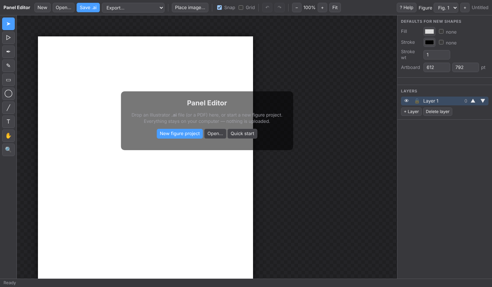

1. Click **New figure project** (or *New* in the top bar). Choose a name and page size.

   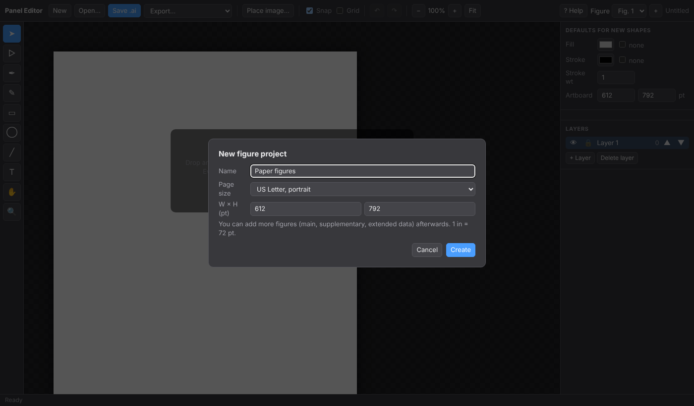

2. Click **Place plot(s)…** in the right-hand *Figure & panels* box and select **both** `cells.pdf` + `cells.json` and
   `ephys.pdf` + `ephys.json` (Ctrl/⌘-click to select several). Shortcut: drag the PDFs onto the window
   (hold **Shift** if you want to *open* a PDF instead of placing it).

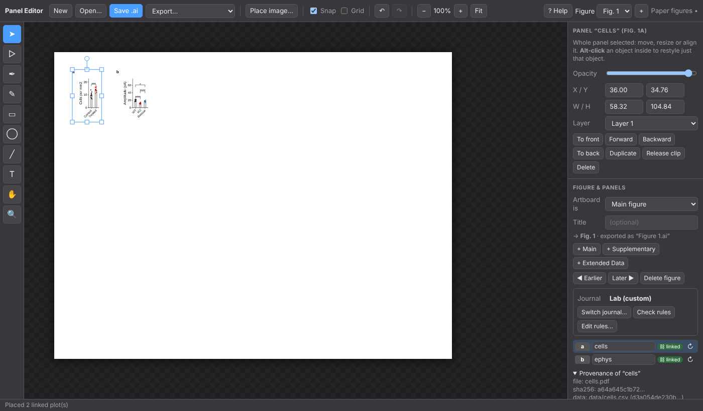

Each plot appears as a **panel**: real, editable vector artwork plus an automatic letter (**a**, **b**). The new panels
go into the next free spot on the grid; anything you had already arranged stays put.

* **Click** anywhere inside a panel to select all of it. **Alt-click** selects one object inside (e.g. a single label).
* The sidebar lists the panels in letter order, with the plot's provenance underneath. 
* Letters are **never typed**. They are computed from the panels' positions (reading order, top row first).

---

## 3. Add a micrograph and a callout

1. **Place image…** (or drop a PNG/JPG on the window) with `examples/tutorial/micrograph.png`. Images are placed as
   panels too, so they get a letter and snap like the plots.
2. Draw an arrow or box over the panel with the **Line** (`\`) or **Rectangle** (`M`) tool.
3. Select the object, then **Shift-click** the panel to add it to the selection, and press **Ctrl/⌘+G**
   (*Group as panel / add to panel*). The callout is now part of that panel: it moves with it, and it survives plot
   updates (step 8).

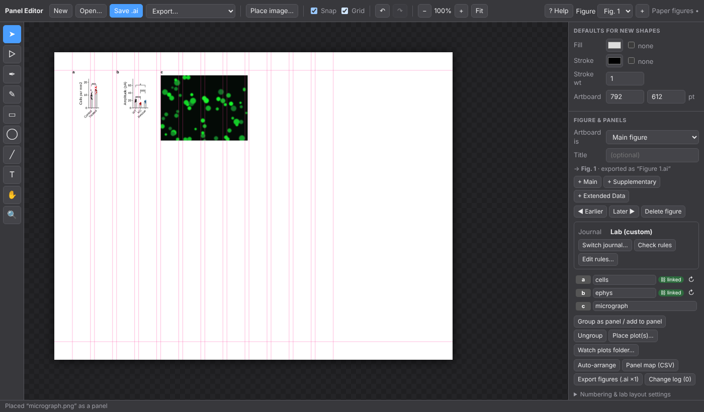

Tick **Grid** in the top bar to show the lab's column grid.

---

## 4. Arrange and snap

* **Drag a panel.** Pink guides appear and its edges and centres snap to its neighbours (**Snap** in the top bar; hold
  **Alt** while dragging to suspend snapping). With **Grid** on, it also snaps to the column lines.
* **Align / distribute.** Select several panels: *Left, Centre, Right, Top, Middle, Bottom, Distribute* buttons appear
  at the bottom of the properties box. They align panel **frames** (the plot area), not letters or callouts.
* **Auto-arrange** (sidebar) tidies everything on the figure at once: reading order, top-aligned rows, left edges on
  column starts, letters above frames. Use it as a reset; it is never run behind your back unless you tick
  *re-flow ALL panels…* under *Numbering & lab layout settings*.
* Columns, gutter, margin, row gap and where the letter sits are editable in that settings block. The defaults are
  placeholders (see the README), so set them to your lab's rules once.

---

## 5. Write a legend that cites panels

1. Choose the **Type** tool (`T`), click on the page and type `Cell counts are shown in `, then press **Ctrl/⌘+Enter**.
2. Select that text object with the Selection tool (`V`). In the properties box choose
   **Insert panel reference…** and pick the cells panel.

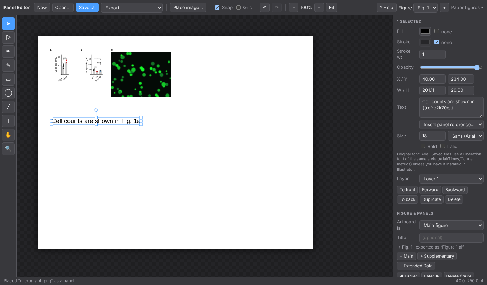

The text now reads "…shown in Fig. 1c". It is stored as `{{ref:…}}`, so it will change by itself whenever the panel's
number changes. (`{{fig:…}}` gives only "Fig. 1", `{{letter:…}}` only "c".)

---

## 6. Move panels around; letters follow

Drag the cells panel to the right of the micrograph.


Every letter, the sidebar list and the reference in the legend update immediately, and the status bar says what
changed. Open **Change log** to see the exact renumbering. This is your checklist for fixing the manuscript text
outside this file:

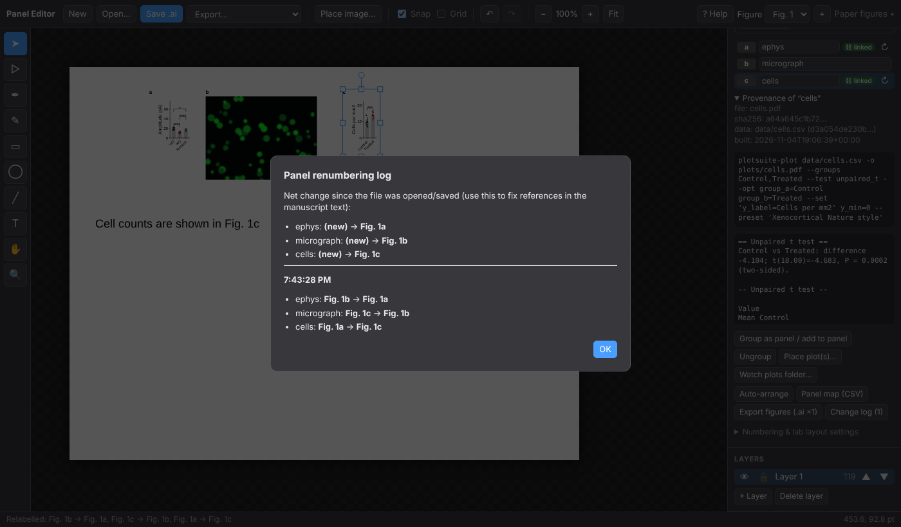

Undo (`Ctrl/⌘+Z`) puts letters *and* references back together. Prefer manual lettering? In *Numbering* choose
**Manual** and use the ▲▼ buttons.

---

## 7. Move a panel to the supplement

1. Add the figure: **+ Supplementary** in the *Figure & panels* box. (There are also **+ Main**, **+ Extended Data**,
   *◀ Earlier / Later ▶*, and *Delete figure*; the figure picker in the top bar shows "Fig. 1", "Supplementary Fig. 1"…)
2. Back on Fig. 1, find the panel in the sidebar list and pick the destination in its **→ fig…** dropdown.

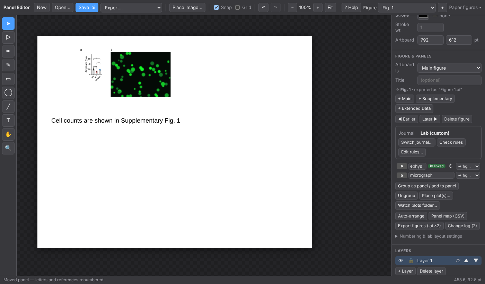

The panel lands on the supplementary figure, the remaining panels close the gap in their lettering, a figure with a
single panel gets no letter, and the legend now says "Supplementary Fig. 1". Reordering or inserting whole figures
renumbers everything the same way.

---

## 8. The data changed

Reviewer asks for a drug group. Edit what the plot should show; here we switch to the prepared manifest:

```bash
cd examples/tutorial
python ../../tools/panel_build.py panels.after.json     # rebuilds ONLY cells; ephys is untouched
```

Now get the new PDF into the figure, any of three ways:

* **↻ button** next to the panel in the sidebar → choose the new `cells.pdf` (+ `cells.json`).
* **Watch plots folder…** (Chrome/Edge): pick the `plots` folder once; the editor checks every few seconds and updates
  any linked panel whose plot changed. Leave `panel_build.py panels.json --watch` running in a terminal and the figure
  follows your data. (Re-pick the folder after reloading the page.)
* **Check now** (appears while watching) forces a check.

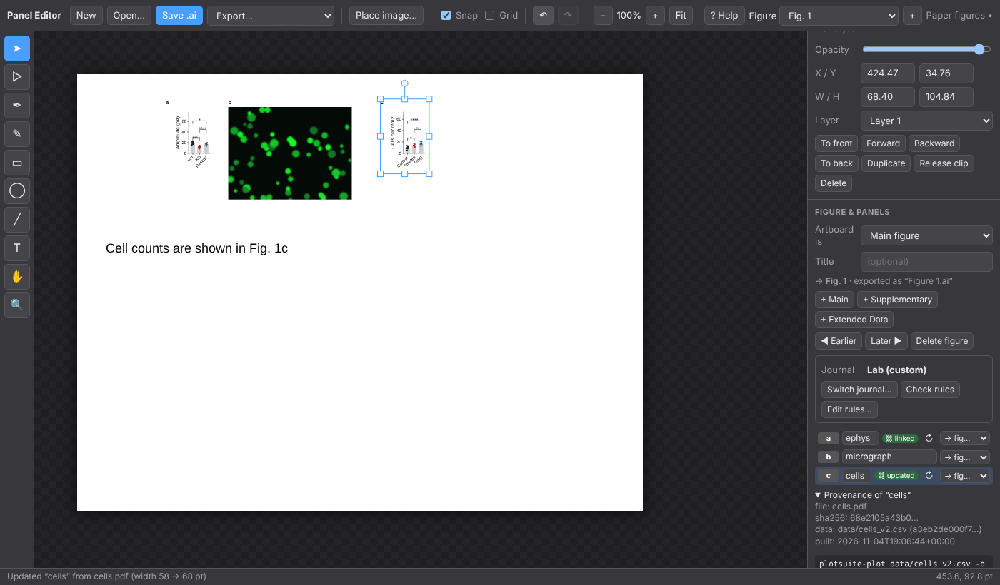

What happens: only the plot artwork is replaced. The letter, your callouts, the panel's position and its scale stay.
If the plot got wider, panels to its right in the same row are shifted aside to make room (you are told which), and
anything still overlapping is flagged. The provenance box shows the new command, data hash and statistics. Undo
reverts the whole update.

---

## 9. Save, share, export

* **Save .ai** (`Ctrl/⌘+S`). In Chrome/Edge, saving again overwrites the same file; other browsers download a copy.
  Panels, links, figure kinds and references are stored inside the file, so reopening it in Panel Editor restores
  everything.
* **Send it to a collaborator**: they open the URL, drop the `.ai` on the window, edit, and send it back.
  They don't need your plots or data; the artwork travels in the file.
* **Export figures (.ai ×N)** writes a zip with `Figure 1.ai`, `Supplementary Figure 1.ai`, … plus `panel-map.csv`.
  The names are exactly what `ai-figures-pdf` expects, so its folder-to-PDF step works on them directly.
* **Panel map (CSV)** lists every panel's label, source file, data file and data hash. Useful as a methods/provenance table.
* *Export…* in the top bar also gives a lean PDF, or an SVG/PNG of the current figure.

---

## 10. Working on an existing Illustrator file

*Open…* or drop the `.ai` in. It must have been saved with **Create PDF Compatible File** (Illustrator's default);
otherwise you get a clear message. Everything imports as editable objects, one artboard per figure
(set each artboard's kind in the sidebar). To get lettering and snapping for what is already there, select the objects
that make up a panel and press `Ctrl/⌘+G`. Check the ⚠ import notes (top-right) for anything that could not be
carried across. Read the README's limits before using this for final art: fonts are substituted on save, colour is
RGB, and a saved file has not been verified inside Adobe Illustrator itself.

---

## 11. Switching journals

Rejected from one journal, going to another? Everything about a figure that depends on the journal is derived,
so the switch is one action.

> **Read this first:** the built-in Nature, Cell and Science numbers are **unverified**. They come from web-search
> summaries of each journal's guidelines (the journals' own pages could not be opened when this was built) and they
> contradict each other in places. See [JOURNAL-RULES.md](JOURNAL-RULES.md) for every value with its source and the
> conflicts. Check them against the journal's current instructions, correct them in **Edit rules…**, and tick
> *I checked these*. Until then the sidebar shows an **unverified** badge.

1. In the **Journal** box of the sidebar, click **Switch journal…**.

   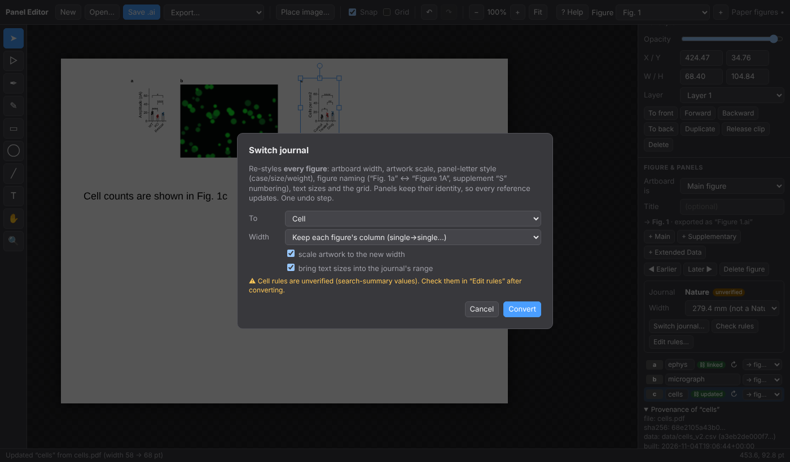

2. Pick the journal. **Width**: keep each figure's column choice (single→single, double→double) or force one for all.
   Leave *scale artwork* ticked to scale each figure uniformly to the new width; untick it to change only the artboard.
   *Bring text sizes into range* resizes text outside the journal's min/max.
3. **Convert.** One undo step. You get a report of what changed:

   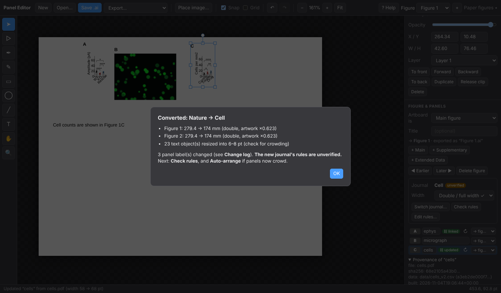

   * artboard width and artwork scale for each figure,
   * panel letters restyled (case, size, weight) and re-lettered (`Fig. 1a` ⇄ `Figure 1A`),
   * supplement naming (`Supplementary Fig. 1` ⇄ `Figure S1` ⇄ `fig. S1`), exported file names included,
   * every `{{ref}}` in your legends updated, and the renumbering added to the **Change log**.
4. **Check rules** lists remaining problems (wrong width, text too small or too large, wrong letter style,
   overlaps, panels outside the artboard) and *select* jumps to the offending objects.

   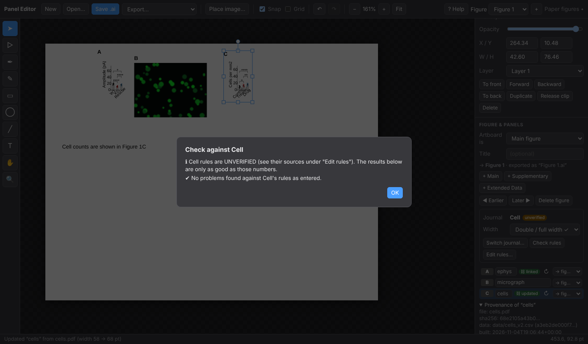

5. After a big down-scale, text may have been enlarged to the journal's minimum and things can crowd: use
   **Auto-arrange**, then fix by hand.

**Edit rules…** changes any number (widths, height, letter style, text range, line weight, name prefixes) and shows
where each value came from:

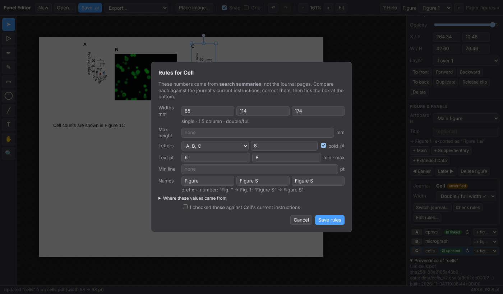

For a single figure, the **Width** dropdown in the Journal box sets just that figure to the journal's single, 1.5 or
double column (artwork scales with it). Your edited rules are saved inside the `.ai`.

## Cheat sheet

| Do this | How |
|---|---|
| Select a whole panel / one object inside | click / **Alt**-click |
| Add to selection | **Shift**-click |
| Move straight | hold **Shift** while dragging |
| Suspend snapping | hold **Alt** while dragging |
| Make a panel from objects / add callouts to a panel | `Ctrl/⌘+G` / ungroup `Ctrl/⌘+Shift+G` |
| Tools | V select · A points · P pen · N pencil · M rect · L ellipse · \\ line · T type · H hand (or hold Space) · Z zoom |
| Nudge | arrow keys (Shift = 10 pt) |
| Fit page / zoom | `Ctrl/⌘+0` / `Ctrl/⌘ +` `−` or `Ctrl`+wheel |
| Undo / redo | `Ctrl/⌘+Z` / `Shift+Z` |
| Save / open | `Ctrl/⌘+S` / `Ctrl/⌘+O` |
| Place PDFs / images | drop on the window (Shift-drop a PDF to open instead) |

## Troubleshooting

**"Folder watching not available."** Only Chrome and Edge have the folder API. Use the ↻ button per panel instead.

**A panel overlaps its neighbour after an update.** The note under the panel list says which; press **Auto-arrange**.

**Letters look wrong.** They follow reading order: panels whose tops are within 30 pt count as one row. If you
want a different order, switch *Order* to Manual.

**`panel_build.py` reports "BLOCKED by guardrails".** plotsuite refused the analysis for this data (the reason is
printed). The old PDF is kept. Fix the data or the test; do not work around it.

**The text of an imported plot looks slightly different from the PDF.** Fonts are substituted
(Nimbus Sans → Liberation Sans, same metrics). Widths are preserved.

**I dropped a PDF and it opened as a new document.** With nothing open, a PDF opens. With a project open it is placed;
hold **Shift** to force-open.

**Where's my data?** Nothing is uploaded anywhere; the editor runs entirely in your browser.
